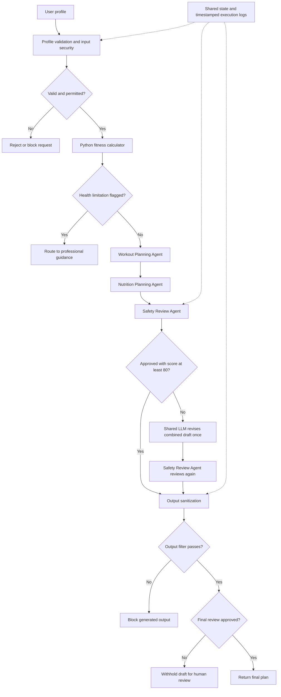

# FitMate AI: Multi-Agent Fitness Planner

FitMate AI is an educational fitness-planning assistant built in Google Colab. It turns a user's goals, experience, available time, equipment, and preferences into a weekly workout plan and general nutrition guidance.

## Problem and target users

Beginners often struggle to turn a fitness goal into a realistic routine. FitMate separates profile validation, workout planning, nutrition planning, and safety review into specialized agents so that generated plans can be checked against the user's needs.

## Project structure

- `FitMate_AI_Multi_Agent_Fitness_Planner.ipynb`: complete implementation, sample profile, monitoring, and demonstration tests.
- `README.md`: project overview, architecture, setup, and usage.

## Technologies

- Python and Google Colab
- LangChain and `langchain-groq`
- Groq-hosted `openai/gpt-oss-120b`, configured as a shared model with temperature 0
- Pandas for execution logs and summaries
- Python standard libraries for validation, JSON handling, timing, and request IDs

## Agents and responsibilities

| Component | Responsibility |
|---|---|
| `InputSecurityAgent` | Validates required fields and ranges and detects common prompt-injection patterns. |
| `ProfileValidationAgent` | Applies input checks, identifies health limitations requiring professional guidance, and invokes the calculator. |
| `WorkoutPlanningAgent` | Generates a weekly schedule with warm-ups, exercises, recovery, and equipment adaptations. |
| `NutritionPlanningAgent` | Generates general balanced meal ideas and hydration guidance. |
| `SafetyReviewAgent` | Reviews drafts and returns a JSON score, approval decision, issues, and feedback. |
| `FitnessPlannerManager` | Coordinates agents, routes rejected or flagged profiles, requests one revision, and sanitizes final output. |

## Architecture diagram and workflow

Agents run sequentially and share a Python dictionary containing the profile, calculations, drafts, review, status, errors, and execution logs.

## Reasoning pattern

The notebook demonstrates Reflection / Self-Critique: generate drafts, review them, revise once using feedback if needed, and review the revised draft. The manager uses the shared LLM for the combined revision. Plans need an approval decision and a score of at least 80 to complete successfully.

## Tool integration

The Python `fitness_calculator` computes BMI when height and weight are supplied. It can also estimate daily energy needs using the Mifflin-St Jeor equation when the additional optional inputs are available. These values are educational estimates rather than prescribed targets.

## Setup

1. Open `FitMate_AI_Multi_Agent_Fitness_Planner.ipynb` in Google Colab through **File > Open notebook > Upload**.
2. Obtain a Groq API key.
3. In Colab's Secrets panel, add a secret named `GROQ_API_KEY` and enable notebook access.
4. Run the installation cell, which installs `langchain`, `langchain-groq`, and `pandas`.
5. Run the remaining cells in order. A working internet connection and Groq model access are required for generation.

The notebook loads the key from Colab Secrets. Do not paste API keys into notebook cells or commit them to GitHub.

## Running the project

1. Run sections 2 through 13 to install dependencies and initialize the model, agents, and manager.
2. Edit `user_profile` in section 14. Required fields are `name`, `age`, `fitness_level`, `goal`, `days_per_week`, `session_minutes`, `equipment`, `diet_preference`, and `limitations`.
3. Use one of the supported goals: `general_fitness`, `strength`, `weight_management`, `endurance`, or `flexibility`. Supported fitness levels are `beginner`, `intermediate`, and `advanced`.
4. Use an integer age from 16 to 100, 1 to 7 training days, and sessions of 10 to 120 minutes. Enter `"none"` for limitations when applicable.
5. Optionally supply `height_cm`, `weight_kg`, `sex_for_energy_estimate`, and `activity_factor` for calculator estimates.
6. Run section 15 to generate the plan and inspect the workflow status.
7. Run section 16 to view the logs and Pandas summary, section 17 for demonstration tests, and section 18 to save results.

## Outputs and monitoring

The notebook displays the workflow status, workout plan, nutrition guidance, review score, duration, and errors. Logs include timestamps, request IDs, statuses, and messages.

The save cell writes `fitmate_final_plan.txt` and `fitmate_execution_logs.csv` in the Colab runtime. Download these files from Colab if you want to keep them after the session ends.

Possible statuses include `completed`, `rejected`, `blocked`, `needs_professional_guidance`, `blocked_by_output_filter`, and `needs_human_review`, and `failed`.

## Security mechanisms

- Required-field, allowed-value, and range validation before generation.
- Pattern-based prompt-injection detection in free-text fields.
- Prompts that treat profile and draft text as untrusted data.
- Professional-guidance routing for recognized health-related limitations.
- Output filtering for common email and phone patterns and selected unsafe phrases.
- Automated review with a limited revision loop and a human-review status that withholds drafts when approval fails.

These are lightweight educational safeguards. Pattern matching can miss attacks or flag harmless content, and the notebook does not provide a human approval interface.

## Testing

Section 17 uses assertions and scripted model responses to check the actual workflow without API calls. It covers normal completion, logging and timing, calculator output, invalid input, prompt injection, professional-guidance routing, the revision loop, failed review, malformed review JSON, invalid approval types, unsafe output, PII masking, and a simulated API outage.

These tests check control flow and guardrails. Run section 15 with a Groq key to assess the quality of live generated plans.

## Limitations and future improvements

- Add a verified exercise database and reliable nutrition sources.
- Expand structured validation of model outputs.
- Expand adversarial testing and live model evaluation.
- Add user feedback, progress tracking, and a human approval interface.
- Improve input and output filtering beyond phrase matching.
- Consider LangGraph for more advanced conditional orchestration.

FitMate provides general educational wellness information. It does not diagnose conditions or prescribe treatment. Users with injuries, medical conditions, pregnancy, or other special circumstances should seek qualified professional guidance before following a personalized plan.

## Academy reference

[SDAIA Academy GitHub](https://github.com/SDAIAAcademy)
